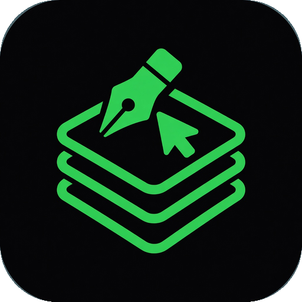
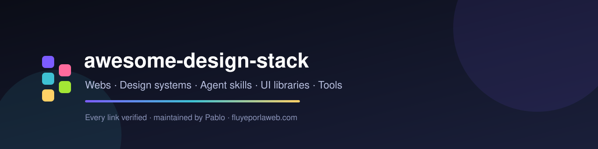

  

<h1 align="center">awesome-design-stack</h1>

<a href="README.md">English</a> &#183; <strong>Español</strong>

  
  
  
  

> Una colección de **recursos de diseño web** para quienes construyen: **inspiración UI** de cada tipo de pantalla, **sistemas de diseño**, **skills para agentes** (Claude, Cursor, opencode), bibliotecas de componentes, color, tipografía, iconos y herramientas. Todos los enlaces están comprobados y la lista entera se revisa cada semana.

Las grandes listas de diseño llevan años sin mantenerse, mientras el trabajo cambió de sitio: eliges un sistema de diseño, sueltas un `DESIGN.md` en tu repo para que tu agente de código diseñe como un senior, y coges componentes en vez de reinventarlos. Una sola lista para todo el stack, en castellano e inglés.

## Contenido

- [🎨 Galerías de inspiración](#galerías-de-inspiración) (25)
- [🖥️ Galerías por tipo de pantalla](#galerías-por-tipo-de-pantalla) (9)
- [🧭 Bibliotecas de patrones de UI](#bibliotecas-de-patrones-de-ui) (12)
- [🧩 Sistemas de diseño y guías](#sistemas-de-diseño-y-guías) (19)
- [🤖 Skills de agentes para diseño](#skills-de-agentes-para-diseño) (19)
- [🧱 Componentes y bibliotecas de UI](#componentes-y-bibliotecas-de-ui) (36)
- [📄 Plantillas y kits de UI](#plantillas-y-kits-de-ui) (10)
- [🌈 Color](#color) (20)
- [✍️ Tipografía](#tipografía) (21)
- [🔖 Iconos](#iconos) (22)
- [🖼️ Ilustraciones](#ilustraciones) (12)
- [📸 Fotos, vídeo y 3D](#fotos-vídeo-y-3d) (16)
- [🎞️ Animación y movimiento](#animación-y-movimiento) (8)
- [🧪 Generadores de CSS y fondos](#generadores-de-css-y-fondos) (26)
- [✏️ Herramientas de diseño y prototipado](#herramientas-de-diseño-y-prototipado) (13)
- [🪄 Herramientas de diseño con IA](#herramientas-de-diseño-con-ia) (8)
- [📚 Aprendizaje, UX y accesibilidad](#aprendizaje-ux-y-accesibilidad) (27)
- [🧰 Utilidades](#utilidades) (11)
- [Contribuir](#contribuir)
- [Licencia](#licencia)

## 🎨 Galerías de inspiración

Webs reales de las que robar estructura (nunca píxeles: siempre patrones).

- [Land-book](https://land-book.com) - Páginas de aterrizaje y diseños web elegidos a mano, con filtros por sector y elemento de interfaz.
- [Lapa Ninja](https://lapa.ninja) - Galería gratuita enorme de landings, con filtros por elemento, color y estilo, y kits de UI de regalo.
- [Awwwards](https://www.awwwards.com) - Los premios al mejor diseño web del planeta: ganadores, finalistas y notas del jurado.
- [CSS Design Awards](https://www.cssdesignawards.com) - Premios y galería de webs con menciones a la UI, la UX y la innovación.
- [The FWA](https://thefwa.com) - Premios de diseño digital desde 2000; cada entrada recibe una crítica escrita.
- [Httpster](https://httpster.net) - Vitrina de webs hechas con oficio y sin postureo.
- [Curated Design](https://curated.design) - Diseño web de nivel de premio, elegido a mano y filtrable por estilo y etiqueta.
- [One Page Love](https://onepagelove.com) - Galería de webs de una sola página, con plantillas y despiece de landings.
- [Minimal Gallery](https://minimal.gallery) - Diseños web minimalistas, con selección semanal.
- [Landingfolio](https://www.landingfolio.com) - Inspiración de landings con capturas de cada sección que puedes reutilizar.
- [Cosmos](https://www.cosmos.so) - Descubrimiento visual y moodboards para guardar inspiración mientras navegas.
- [Recent.design](https://recent.design) - Cómo se ve la web ahora mismo: diseños nuevos añadidos a diario.
- [Dark Mode Design](https://www.darkmodedesign.com) - Galería de webs e interfaces en modo oscuro.
- [Dark Design](https://www.dark.design) - Webs de tema oscuro elegidas a mano, de diseñadores para diseñadores.
- [Dribbble](https://dribbble.com/shots) - Donde los diseñadores cuelgan sus shots: la referencia de estilo más rápida que existe.
- [Web Design Inspiration](https://www.webdesign-inspiration.com) - Miles de webs vivas agrupadas por tipo, estilo y sector.
- [SaaS Landing Page](https://www.saaslandingpage.com) - Landings de productos SaaS organizadas por categoría.
- [Call To Idea](https://www.calltoidea.com) - Clásico pero útil: ejemplos reales y rápidos de botones, formularios, footers y tarjetas.
- [Footer Design](https://footer.design) - Toda una galería de footers: la parte que todos diseñan al final y peor.
- [Best Website Gallery](https://bestwebsite.gallery) - La antigua galería de la CSSDA: limpia, etiquetada y con buscador.
- [CSS Winner](https://www.csswinner.com) - Premios y galería de webs, con buen ojo para el detalle.
- [Design Nominees](https://www.designnominees.com) - Webs, apps y juegos nominados y premiados.
- [CSSFox](https://cssfox.co) - Vitrina donde developers y agencias puntúan y premian su trabajo web.
- [Web Design File](https://www.webdesignfile.com) - Un archivador de webs notables, ordenadas por tipo y color.
- [Abduzeedo](https://abduzeedo.com) - Inspiración diaria y tutoriales desde 2006.

## 🖥️ Galerías por tipo de pantalla

La cura para "otra web que parece hecha por IA": cientos de ejemplos reales de la pantalla exacta que estás diseñando: emails, precios, 404, onboarding, estados vacíos. Pásaselos a tu agente antes de que improvise.

- [Checklist Design](https://www.checklist.design) - Checklists de lo que necesita cada tipo de página: home, precios, 404, onboarding.
- [SaaSFrame](https://www.saasframe.io) - Pantallas y flujos de productos SaaS reales: onboarding, precios, ajustes, emails.
- [Really Good Emails](https://www.reallygoodemails.com) - La mayor biblioteca de emails reales, navegable por tipo y marca.
- [Good Email Copy](https://www.goodemailcopy.com) - Fragmentos de textos de email de empresas reales, ordenados por situación.
- [Email Love](https://emaillove.com) - Diseño de email elegido a mano de productos reales, con el despiece de cada uno.
- [Pricing Pages](https://pricingpages.com) - Páginas de precios de productos SaaS, una al día.
- [Empty States](https://emptystat.es) - La colección clásica de estados vacíos que merecen copiarse.
- [User Onboard](https://www.useronboard.com) - Samuel Hulick desmontando flujos de onboarding famosos, pantalla a pantalla.
- [GoodUI](https://www.goodui.org) - Patrones de UI con pruebas: qué variante convirtió mejor y por cuánto.

## 🧭 Bibliotecas de patrones de UI

Bibliotecas con buscador de patrones reales de UI: navegación, formularios, flujos, visualización de datos.

- [Refero](https://refero.design) - Busca pantallas reales de los mejores productos web y móviles por palabra clave.
- [Mobbin](https://mobbin.com) - Pantallas iOS, Android y web de apps y sitios reales, con flujos y patrones.
- [Pttrns](https://www.pttrns.com) - Patrones móviles y web, clasificados por tipo de pantalla y elemento.
- [UI Garage](https://www.uigarage.net) - Patrones de UI web por categorías: formularios, tablas, onboarding, footers, navbars.
- [Page Flows](https://pageflows.com) - Vídeos completos de flujos (registro, onboarding, upgrade) de productos famosos.
- [Nicely Done](https://nicelydone.club) - Capturas reales de flujos de SaaS bien diseñados.
- [NavNav](https://navnav.co) - Todo tipo de patrones de navegación, con vista previa en vivo y código.
- [Hover Stat.es](https://hoverstat.es) - Galería de estados hover y microinteracciones que dan envidia.
- [Collect UI](https://collectui.com) - Retos de Daily UI resueltos por diseñadores, con buscador por elemento.
- [UI Patterns](https://ui-patterns.com) - Biblioteca de patrones que explica el razonamiento UX detrás de cada uno.
- [Dataviz Catalogue](https://datavizcatalogue.com) - Cada método de visualización de datos, explicado y comparado.
- [From Data to Viz](https://www.data-to-viz.com) - Elige el gráfico correcto según la forma de tus datos, con sus avisos.

## 🧩 Sistemas de diseño y guías

Cómo lo hacen los equipos grandes: tokens, componentes y reglas que puedes tomar prestadas.

- [Material 3](https://m3.material.io) - El sistema de diseño open source de Google: tokens, componentes y guía para web y apps.
- [Apple Human Interface Guidelines](https://developer.apple.com/design/human-interface-guidelines/) - Las HIG de Apple: una referencia de calidad de interfaz que va más allá de sus plataformas.
- [Fluent 2](https://fluent2.microsoft.design) - El sistema de diseño multiplataforma de Microsoft.
- [Carbon Design System](https://carbondesignsystem.com) - El sistema open source de IBM para productos y experiencias digitales.
- [Polaris](https://polaris.shopify.com) - El sistema de Shopify, con patrones sólidos de comercio y paneles de administración.
- [Atlassian Design System](https://atlassian.design) - Componentes y guías detrás de Jira, Confluence y toda la suite de Atlassian.
- [Primer](https://primer.style) - El sistema de diseño de GitHub, con documentación y componentes React.
- [Spectrum](https://spectrum.adobe.com) - El sistema de diseño de Adobe para sus apps profesionales y productos web.
- [Lightning Design System](https://www.lightningdesignsystem.com) - El sistema de Salesforce y una referencia enorme de componentes.
- [PatternFly](https://www.patternfly.org) - El sistema de diseño abierto de Red Hat para interfaces empresariales.
- [Pajamas](https://design.gitlab.com) - El sistema de diseño de GitLab: componentes, guías de contenidos y métodos de investigación.
- [Backpack](https://backpack.github.io) - El sistema de diseño de Skyscanner para productos de viaje.
- [Elastic UI Framework](https://eui.elastic.co/) - La biblioteca de componentes que alimenta Kibana.
- [Nord](https://nordhealth.design) - El sistema accesible de Nordhealth para productos de salud.
- [U.S. Web Design System](https://designsystem.digital.gov) - El sistema de diseño del Gobierno de EE. UU.: un modelo de UI accesible y sobria.
- [UNDP Design System](https://design.undp.org) - El sistema de diseño global del PNUD para sus productos y contenidos digitales.
- [Design Systems Repo](https://designsystemsrepo.com) - Directorio de sistemas de diseño por empresa, con artículos y comunidad.
- [DesignSystems.com](https://www.designsystems.com) - El punto de encuentro de la comunidad de sistemas de diseño: artículos, ejemplos y empleo.
- [Open UI](https://open-ui.org) - Investigación comunitaria para que los componentes de UI funcionen igual en todos los frameworks.

## 🤖 Skills de agentes para diseño

Haz que Claude, Cursor u opencode diseñen como un senior: ficheros `DESIGN.md`, reglas y bibliotecas de skills.

- [anthropics/skills](https://github.com/anthropics/skills) - El repo oficial de skills de Anthropic: implementaciones de referencia de las que aprender.
- [taste-skill](https://github.com/Leonxlnx/taste-skill) - Skills que le dan buen ojo al agente de código: dirección de arte, imágenes de referencia y revisión en navegador, en vez de páginas genéricas de IA.
- [awesome-design-md](https://github.com/VoltAgent/awesome-design-md) - Ficheros DESIGN.md destilados de sistemas de diseño de marcas conocidas: suelta uno en tu proyecto y el agente diseña como esa marca.
- [awesome-claude-design](https://github.com/VoltAgent/awesome-claude-design) - Inspiraciones de sistemas de diseño listas para usar en formato DESIGN.md, para Claude y otros agentes.
- [awesome-design-skills](https://github.com/bergside/awesome-design-skills) - Ficheros de skills de diseño (DESIGN.md y SKILL.md) para Claude, Cursor y otras herramientas agénticas.
- [awesome-claude-skills](https://github.com/ComposioHQ/awesome-claude-skills) - La gran lista curada de skills de Claude, recursos y herramientas.
- [awesome-claude-code](https://github.com/hesreallyhim/awesome-claude-code) - Los mejores recursos para Claude Code: plugins, ejemplos de CLAUDE.md y flujos de trabajo.
- [awesome-cursorrules](https://github.com/PatrickJS/awesome-cursorrules) - Ficheros .cursorrules y reglas para Cursor, organizados por stack.
- [awesome-shadcn-ui](https://github.com/birobirobiro/awesome-shadcn-ui) - Todo shadcn/ui: plantillas, plugins y registros de componentes construidos encima.
- [superpowers](https://github.com/obra/superpowers) - Una biblioteca de skills que le dan a Claude Code flujos de experto y disciplina de proceso.
- [good-css](https://github.com/vojtaholik/good-css) - Técnicas CSS modernas con carácter, en formato skill, cada una con su ejemplo en vivo.
- [diagram-design](https://github.com/cathrynlavery/diagram-design) - Diagramas con estilo editorial para agentes de código: 52 tipos de diagrama en HTML autocontenido.
- [LottieFiles motion-design-skill](https://github.com/LottieFiles/motion-design-skill) - Principios de motion design para agentes: timing, easing y coreografía, adaptados a la UI.
- [motion-dev-animations-skill](https://github.com/199-biotechnologies/motion-dev-animations-skill) - Skill de Claude para Motion.dev: muelles, efectos de scroll e interacciones con gestos.
- [GSAP skills](https://github.com/greensock/gsap-skills) - Skills oficiales de GSAP: enseñan al agente a usarlo bien.
- [Vercel skills CLI](https://github.com/vercel-labs/skills) - La herramienta abierta de skills para agentes (`npx skills`) para instalarlas y gestionarlas en cualquier proyecto.
- [opencode](https://opencode.ai) - Agente de código open source en el terminal, con soporte de skills: buena base para un stack de diseño.
- [AnimatedWebs](https://animatedwebs.com) - Prompts de webs animadas (WebGL, shaders, scroll), con un servidor MCP al que tu agente puede consultar.
- [Superdesign](https://superdesign.dev) - Un agente de diseño con IA que convierte prompts en maquetas, pantallas y componentes.

## 🧱 Componentes y bibliotecas de UI

Coge componentes ya hechos en vez de reinventarlos: primitivas headless, sets con estilo, los animados.

- [shadcn/ui](https://ui.shadcn.com) - Componentes de copiar y pegar sobre Radix y Tailwind; el estándar de facto de la UI moderna.
- [Radix Primitives](https://github.com/radix-ui/primitives) - Primitivas React sin estilos y accesibles para componer tu propio sistema de diseño.
- [Radix Colors](https://www.radix-ui.com/colors) - Escalas de color perceptualmente uniformes, calibradas para accesibilidad.
- [Headless UI](https://github.com/tailwindlabs/headlessui) - Componentes accesibles sin estilos para React y Vue, del equipo de Tailwind.
- [Base UI](https://base-ui.com) - Componentes accesibles sin estilos, del equipo de MUI, pensados para que los estilices.
- [Melt UI](https://melt-ui.com) - Constructores headless de componentes Svelte: el Radix de Svelte.
- [Bits UI](https://www.bits-ui.com) - Componentes headless para Svelte 5, pensados para ir con Tailwind.
- [shadcn-svelte](https://shadcn-svelte.com) - El concepto de shadcn/ui llevado a Svelte.
- [daisyUI](https://github.com/saadeghi/daisyui) - Plugin de Tailwind con clases semánticas de componentes: UI rápida sin escribir utilidades.
- [Magic UI](https://github.com/magicuidesign/magicui) - Componentes y efectos animados de copiar y pegar, pensados para shadcn/Tailwind.
- [Aceternity UI](https://ui.aceternity.com) - Componentes de copiar y pegar con mucha animación: los de esos heros que ves por todas partes.
- [Inspira UI](https://inspiraui.com) - Componentes animados al estilo shadcn, para Vue y Nuxt.
- [Animata](https://animata.design) - Cientos de componentes React animados y gratis, de copiar y pegar con Tailwind.
- [Motion Primitives](https://github.com/ibelick/motion-primitives) - Una biblioteca de componentes con movimiento ya resueltos para React, sobre Motion.
- [React Bits](https://www.reactbits.dev) - Un catálogo de componentes React animados y efectos, con sandboxes de código.
- [Uiverse](https://uiverse.io) - La mayor biblioteca comunitaria de elementos de UI open source, en CSS o Tailwind.
- [HeroUI](https://github.com/heroui-inc/heroui) - Componentes React totalmente accesibles estilizados con Tailwind (antes NextUI).
- [Mantine](https://github.com/mantinedev/mantine) - Más de 100 componentes React con hooks y tema oscuro de serie.
- [Ant Design](https://github.com/ant-design/ant-design) - Biblioteca React de nivel empresarial con un catálogo enorme de componentes y design tokens.
- [Chakra UI](https://github.com/chakra-ui/chakra-ui) - Sistema de componentes React accesible con una API de theming muy buena.
- [Material UI](https://mui.com) - La implementación de Material Design para React, con un ecosistema enorme.
- [Tremor](https://github.com/tremorlabs/tremor) - Componentes React para dashboards y gráficos, sobre Tailwind.
- [Park UI](https://github.com/chakra-ui/park-ui) - Componentes con estilo sobre Ark UI para React, Vue y Solid.
- [Bulma](https://bulma.io) - Framework CSS basado en Flexbox, con clases legibles y nada de JavaScript.
- [Bootstrap](https://getbootstrap.com) - El framework CSS que sigue en todas partes: documentación y ecosistema enormes.
- [Flowbite](https://flowbite.com) - Biblioteca open source de componentes Tailwind, de navbars a gráficos.
- [Preline](https://preline.co) - Componentes Tailwind open source con su Figma a juego.
- [HyperUI](https://www.hyperui.dev) - Componentes Tailwind gratis, de hero sections a ecommerce.
- [Meraki UI](https://merakiui.com) - Componentes Tailwind gratis con soporte RTL completo.
- [Float UI](https://floatui.com) - Componentes y plantillas Tailwind con un aspecto por defecto limpio.
- [Kibo UI](https://www.kibo-ui.com) - Un registro propio de componentes shadcn componibles y accesibles.
- [Tailwind Flex](https://tailwindflex.com) - Una biblioteca comunitaria grande de ejemplos Tailwind con vista previa en vivo.
- [Tailgrids](https://tailgrids.com) - Biblioteca de componentes React open source y sistema de diseño, sobre Tailwind.
- [Tailwind CSS](https://github.com/tailwindlabs/tailwindcss) - El framework CSS de utilidades que sostiene la mayoría de stacks de diseño modernos.
- [21st.dev](https://21st.dev) - Mercado comunitario de componentes React y patrones de UI de copiar y pegar.
- [Hover.dev](https://hover.dev) - Aprende a construir UI web real con React, Tailwind y Motion, construyendo.

## 📄 Plantillas y kits de UI

Puntos de partida para lo que nunca deberías diseñar desde cero.

- [Figma Community](https://www.figma.com/community) - Miles de kits de UI, mockups y ficheros de diseño gratis y de pago de la comunidad.
- [UI Design Daily](https://www.uidesigndaily.com) - Un recurso de UI open source cada día: tarjetas, formularios, dashboards.
- [HTML5 UP](https://html5up.net) - Plantillas HTML5 responsivas y gratis, con fuerte dirección de arte.
- [Start Bootstrap](https://startbootstrap.com) - Plantillas y temas Bootstrap gratis, de landings a paneles de administración.
- [Cruip](https://cruip.com) - Plantillas de landing para startups: Tailwind, React, Vue y HTML plano.
- [TReact](https://treact.owaiskhan.me) - Plantillas React modernas y gratis para landings, hechas con TailwindCSS.
- [Windy Toolbox](https://windytoolbox.com) - Plantillas base, componentes y generadores de Tailwind (antes Tailwind Toolbox).
- [Tailwind Templates](https://tailwindtemplates.io) - Plantillas y componentes Tailwind gratis con vista previa al instante.
- [Tailwind Kit](https://www.tailwind-kit.com) - Una biblioteca de componentes y secciones Tailwind, en Vue 3.
- [Free Frontend](https://freefrontend.com) - Miles de recursos frontend gratis: CSS, JavaScript, React, Tailwind.

## 🌈 Color

Paletas, generadores y herramientas de contraste que mantienen el resultado accesible.

- [Coolors](https://coolors.co) - El generador de paletas más rápido que existe; paletas en tendencia, comprobador de contraste y más.
- [Realtime Colors](https://www.realtimecolors.com) - Visualiza paletas, fuentes y estilos sobre una landing real, en directo.
- [Happy Hues](https://www.happyhues.com) - Paletas mostradas aplicadas a una web real, con códigos hex y notas de uso.
- [Color Hunt](https://colorhunt.co) - Paletas en tendencia elegidas a mano, renovadas a diario.
- [Adobe Color](https://color.adobe.com) - Rueda de color con reglas de armonía, extracción desde imágenes y herramientas de accesibilidad.
- [UI Colors](https://uicolors.app) - Genera toda la gama de tonos Tailwind a partir de un solo hex.
- [Colorbox](https://colorbox.io) - La herramienta de Lyft para construir escalas de color accesibles desde un color base.
- [Accessible Palette](https://accessiblepalette.com) - Genera paletas de UI con luminosidad perceptual pareja, de Rauno Freiberg.
- [Leonardo](https://leonardocolor.io) - Genera colores según el contraste que quieras; hecho por Adobe para temas adaptativos.
- [WhoCanUse](https://www.whocanuse.com) - Comprueba un par de colores contra deficiencias visuales simuladas y pantallas reales.
- [Contrast Ratio](https://www.siegemedia.com/contrast-ratio) - El comprobador de contraste de un solo campo de Lea Verou: instantáneo y sin adornos.
- [OKLCH Color Picker](https://oklch.com) - Elige colores en OKLCH, el espacio de color perceptual que se lleva bien con CSS.
- [Khroma](https://www.khroma.co) - Un generador de paletas entrenado con los colores que te gustan.
- [Huemint](https://huemint.com) - Genera esquemas de color para contextos concretos: webs, marcas, degradados.
- [Eva Colors](https://colors.eva.design) - Generador de paletas con deep learning que equilibra tu color primario.
- [Paletton](https://paletton.com) - La rueda de color clásica para construir paletas complementarias.
- [Pigment by Shapefactory](https://pigment.shapefactory.co) - Mezcla dos colores en un degradado y encuentra la paleta entre ambos.
- [Colors and Fonts](https://www.colorsandfonts.com) - Paletas de color y parejas de fuentes una al lado de la otra, de Michael Andreuzza.
- [Culrs](https://culrs.com) - Cientos de paletas curadas, con buscador por ánimo y tono.
- [RandomA11y](https://randoma11y.com) - Un flujo infinito de combinaciones de color aleatorias, pero siempre accesibles.

## ✍️ Tipografía

Dónde encontrar fuentes, cómo emparejarlas y cómo escalarlas.

- [Google Fonts](https://fonts.google.com) - La biblioteca de fuentes web gratis, con filtros por caso de uso e idioma.
- [Fontsource](https://fontsource.org) - Aloja tú mismo las fuentes de Google como paquetes npm, sin peticiones externas.
- [Fontshare](https://www.fontshare.com) - Fuentes profesionales gratis de la Indian Type Foundry, con API.
- [Typewolf](https://www.typewolf.com) - Recomendaciones y parejas de fuentes vistas en webs reales.
- [Fonts In Use](https://fontsinuse.com) - Un archivo de tipografía del mundo real, por sector y formato.
- [Fontpair](https://www.fontpair.co) - Parejas de Google Fonts, navegables por estilo.
- [Fontjoy](https://fontjoy.com) - Genera parejas de fuentes con deep learning y fija las que te gusten.
- [Utopia](https://utopia.fyi) - Escalas fluidas de tipo y espacio que se estiran suavemente entre breakpoints.
- [Type Scale](https://typescale.com) - Calculadora visual de escala tipográfica modular con salida en px/rem/em.
- [Fluid Type Scale](https://www.fluid-type-scale.com) - Genera tipografía fluida con clamp() sin hacer la ecuación a mano.
- [Modular Scale](https://www.modularscale.com) - La calculadora de Tim Brown para construir escalas sobre una proporción con sentido.
- [Free Faces](https://www.freefaces.gallery) - Una galería navegable de fuentes gratis, elegidas con criterio.
- [V-Fonts](https://v-fonts.com) - Encuentra y prueba fuentes variables en el navegador.
- [Font Squirrel](https://www.fontsquirrel.com) - Fuentes gratis revisadas a mano y con licencia para uso comercial.
- [The League of Moveable Type](https://www.theleagueofmoveabletype.com) - La fundición tipográfica open source pionera; casa de League Gothic.
- [Open Font Library](https://fontlibrary.org) - Fuentes con licencia abierta, buscables y descargables para cualquier uso.
- [Velvetyne](https://velvetyne.fr) - Fuentes display open source de un colectivo de fundidores francés.
- [Inter](https://rsms.me/inter/) - La familia tipográfica de UI de Rasmus, diseñada para pantallas, con ejes variables.
- [JetBrains Mono](https://www.jetbrains.com/lp/mono/) - Una monoespaciada gratis hecha para developers, con ligaduras y altura de x alta.
- [Monaspace](https://monaspace.githubnext.com) - La superfamilia variable de GitHub: cinco monoespaciadas con "textura que se autocorrige".
- [Fonts Bunny](https://fonts.bunny.net) - Las fuentes de Google servidas desde un proxy europeo que respeta la privacidad.

## 🔖 Iconos

Sets de iconos completos y consistentes, con paquetes para tu stack.

- [Lucide](https://lucide.dev) - Iconos open source con trazo consistente, empaquetados para todos los frameworks.
- [Heroicons](https://heroicons.com) - Iconos SVG del equipo de Tailwind: contorno, sólido y mini.
- [Phosphor](https://phosphoricons.com) - Una familia de iconos en seis pesos, disponible para todos los frameworks.
- [Iconify](https://iconify.design) - Un solo framework para más de 200.000 iconos de todos los sets, bajo demanda.
- [Icones](https://icones.js.org) - Busca en todas las colecciones de Iconify y copia como SVG o componente.
- [Tabler Icons](https://tabler.io/icons) - Miles de iconos SVG de trazo con licencia MIT, todos consistentes.
- [Feather Icons](https://feathericons.com) - Iconos open source simplemente bonitos y consistentes.
- [Remix Icon](https://remixicon.com) - Casi 3.000 iconos en dos estilos, del equipo de Remix.
- [Boxicons](https://boxicons.com) - Más de 1.500 iconos cuidados en tres variantes.
- [Iconoir](https://iconoir.com) - Una familia creciente de más de 1.500 iconos, con librerías para React y React Native.
- [css.gg](https://css.gg) - Más de 700 iconos de UI en CSS puro, sin ficheros SVG.
- [Pictogrammers](https://pictogrammers.com) - La casa de los Material Design Icons y su enorme set comunitario.
- [Material Symbols](https://fonts.google.com/icons) - El set actual de Google como fuente variable: peso, grado y relleno.
- [Simple Icons](https://simpleicons.org) - Logos SVG de todas las marcas importantes, con paquetes para npm y CMS.
- [Akar Icons](https://akaricons.com) - Un set perfectamente redondeado de más de 150 iconos, gratis para todo.
- [Zondicons](https://www.zondicons.com) - Un set pequeño y gratis de 20 iconos de Steve Schoger.
- [Untitled UI Icons](https://www.untitledui.com/free-icons) - Un pack inicial de más de 1.300 iconos a juego con el estilo de Untitled UI.
- [3dicons](https://3dicons.co) - Más de 1.440 iconos 3D open source renderizados en cuatro ángulos, sin atribución.
- [Lordicon](https://lordicon.com) - Iconos animados, listos como Lottie, GIF o JSON.
- [The Noun Project](https://thenounproject.com) - El mercado clásico de iconos para cualquier concepto que se te ocurra.
- [Icons8](https://icons8.com) - Iconos, ilustraciones y fotos en todos los estilos, con capa gratis y apps.
- [SVG Repo](https://www.svgrepo.com) - Más de 500.000 iconos y vectores SVG con licencia abierta, con buscador.

## 🖼️ Ilustraciones

Ilustraciones open source y gratis que puedes colorear con tu marca.

- [unDraw](https://undraw.co) - Ilustraciones SVG open source, coloreables con tu marca y sin atribución.
- [Storyset](https://storyset.com) - Edita y anima conceptos ilustrados, de la familia de Freepik.
- [Open Doodles](https://www.opendoodles.com) - Doodles gratis de Pablo Stanley: úsalos, colórealos, anima, vende.
- [Humaaans](https://www.humaaans.com) - Ilustraciones de personas que se mezclan y combinan, en SVG.
- [Open Peeps](https://www.openpeeps.com) - Personajes dibujados a mano que compones en CSS o SVG.
- [DrawKit](https://www.drawkit.com) - Packs de ilustración SVG gratis y de pago, editables en Figma e Illustrator.
- [Blush](https://blush.design) - Personaliza colecciones de ilustraciones de artistas de todo el mundo; tiene plan gratis.
- [Illlustrations](https://illlustrations.co) - Más de 120 ilustraciones gratis para cualquier uso, CC0.
- [Lukasz Adam Illustrations](https://lukaszadam.com/illustrations) - Ilustraciones vectoriales gratis con licencia MIT, actualizadas cada semana.
- [CocoMaterial](https://cocomaterial.com) - Una biblioteca open source de ilustraciones y patrones dibujados a mano.
- [IRA Design](https://iradesign.io) - Monta tus propias ilustraciones con degradados, de Creative Tim.
- [Pixeltrue Illustrations](https://www.pixeltrue.com/packs) - Packs de ilustraciones y animaciones, gratis para uso personal y comercial.

## 📸 Fotos, vídeo y 3D

Fotos, vídeos y assets 3D gratis, casi todo CC0, para páginas de verdad.

- [StockSnap](https://www.stocksnap.io) - Fotos gratis en alta resolución con CC0, con buscador por etiqueta.
- [Kaboompics](https://kaboompics.com) - Fotografía lifestyle cálida, gratis para uso comercial, con paletas a juego.
- [Negative Space](https://negativespace.co) - Fotos gratis con mucho aire para el texto, CC0.
- [Life of Pix](https://www.lifeofpix.com) - Fotos gratis en alta resolución de fotógrafos de todo el mundo.
- [Gratisography](https://gratisography.com) - Las fotos gratis de Ryan McGuire: raras y maravillosas.
- [Iso Republic](https://isorepublic.com) - Miles de fotos y vídeos gratis en alta resolución.
- [SplitShire](https://www.splitshire.com) - Fotos y vídeos libres de royalties con un punto más humano.
- [Freestocks](https://freestocks.org) - Fotos gratis para uso comercial, sin letra pequeña.
- [Magdeleine](https://magdeleine.co) - Una foto elegida a mano cada día, CC0 y dominio público.
- [Shopify Stock Photos](https://www.shopify.com/stock-photos) - Miles de fotos gratis pensadas para comercio y producto.
- [Coverr](https://coverr.co) - Vídeos y música gratis para secciones hero.
- [Mixkit](https://mixkit.co) - Clips de vídeo, gráficos en movimiento y efectos de sonido gratis, de Envato.
- [Poly Pizza](https://poly.pizza) - Miles de modelos 3D low-poly gratis, con supervivientes de Google Poly.
- [Quaternius](https://quaternius.com) - Packs de assets 3D estilizados y gratis, de ciudades low-poly a personajes animados.
- [Poly Haven](https://polyhaven.com) - HDRI, texturas y modelos 3D en CC0, gestionado por la comunidad.
- [Sketchfab](https://sketchfab.com) - El sitio para publicar y encontrar modelos 3D, con miles descargables.

## 🎞️ Animación y movimiento

Bibliotecas y herramientas para mover la interfaz sin ahogarte en JavaScript.

- [GSAP](https://gsap.com) - La plataforma profesional de animación web: scroll, SVG y timelines.
- [Motion](https://motion.dev) - La biblioteca de animación para React y JS puro, antes Framer Motion.
- [LottieFiles](https://lottiefiles.com) - Miles de animaciones Lottie y las herramientas para llevarlas a cualquier sitio.
- [Rive](https://rive.app) - Gráficos animados e interactivos a 60 fps en todas partes, de la app a la web.
- [Jitter](https://jitter.video) - Diseña contenido animado en el navegador, al estilo Figma, y exporta vídeo.
- [anime.js](https://animejs.com) - Una biblioteca de animación pequeña pero poderosa para CSS, SVG y objetos JS.
- [Theatre.js](https://www.theatrejs.com) - Anima cualquier cosa del navegador con un editor de verdad y keyframes.
- [Auto-Animate](https://auto-animate.formkit.com) - Una línea de código para que el DOM cambie con transiciones suaves.

## 🧪 Generadores de CSS y fondos

Generadores de copiar y pegar para degradados, patrones, sombras, rejillas y divisores.

- [Animista](https://animista.net) - Juega con animaciones CSS, ajústalas y copia el código.
- [Animate.css](https://github.com/animate-css/animate.css) - Animaciones CSS listas para usar en todos los navegadores, una clase cada una.
- [cubic-bezier](https://cubic-bezier.com) - Editor interactivo de curvas cubic-bezier.
- [Easings](https://easings.net) - Chuleta de funciones de easing con demo en vivo.
- [CSS Gradient](https://cssgradient.io) - Generador de degradados con CSS de copiar y pegar y tutoriales sin humo.
- [Gradient Magic](https://www.gradientmagic.com) - Una galería enorme de degradados CSS que no se repiten.
- [Mesh Gradient](https://meshgradient.in) - Genera y exporta degradados de malla como PNG, gratis.
- [Trianglify](https://trianglify.io) - Generador de patrones low-poly para fondos.
- [Shape Dividers](https://www.shapedividers.com) - Divisores de sección en SVG, generados de forma visual.
- [Haikei](https://haikei.app) - Generadores SVG de blobs, olas, degradados y fondos low-poly.
- [fffuel](https://www.fffuel.co) - Generadores de ilustraciones, color y recursos SVG, todo en un sitio.
- [Belick Backgrounds](https://bg.ibelick.com) - Generador de fondos modernos (rejillas, puntos, degradados) que devuelve Tailwind.
- [Hero Patterns](https://heropatterns.com) - Patrones SVG repetibles de Steve Schoger, recoloreables con un clic.
- [pattern.css](https://bansal.io/pattern-css) - Llena fondos vacíos con patrones solo de CSS, sin imágenes.
- [Transparent Textures](https://transparenttextures.com) - Ruidos y texturas sutiles, copiadas como CSS.
- [Subtle Patterns](https://www.toptal.com/designers/subtlepatterns/) - El archivo clásico de texturas sutiles para fondos.
- [SVG Backgrounds](https://www.svgbackgrounds.com) - Personaliza fondos y patrones SVG y expórtalos como SVG o CSS.
- [Magic Pattern](https://www.magicpattern.com) - Degradados de malla, blobs, rayas y divisores: cada uno con su generador.
- [Blobmaker](https://www.blobmaker.app) - Haz blobs SVG orgánicos en segundos, con control de tamaño y complejidad.
- [Get Waves](https://getwaves.io) - Genera olas en SVG y úsalas como divisoras de sección.
- [CSSmatic](http://cssmatic.com) - Generadores CSS gratis y un curso de iniciación a dominio.
- [Neumorphism.io](https://neumorphism.io) - Generador CSS de soft-UI (neumorfismo).
- [Glassmorphism](https://squareblack.com/glassmorphism) - Generador de efecto cristal esmerilado con CSS de copiar y pegar.
- [css-doodle](https://css-doodle.com) - Dibuja arte generativo con un web component y CSS puro.
- [CSS Grid Generator](https://cssgrid-generator.netlify.app) - Dibuja una rejilla y recibe el CSS.
- [Layoutit Grid](https://grid.layoutit.com) - Constructor interactivo de CSS grid con plantillas y vista previa en vivo.

## ✏️ Herramientas de diseño y prototipado

De wireframes rápidos a herramientas de diseño completas, incluidas las gratis.

- [Figma](https://www.figma.com) - El estándar de diseño de UI, prototipado y colaboración.
- [Penpot](https://penpot.app) - Plataforma open source de diseño y prototipado: la alternativa autoalojable a Figma.
- [Framer](https://www.framer.com) - Diseña y publica webs de verdad con movimiento de serie.
- [Sketch](https://www.sketch.com) - La herramienta de diseño de macOS, con un ecosistema maduro.
- [Excalidraw](https://excalidraw.com) - Pizarra con aspecto dibujado a mano, gratis y open source.
- [tldraw](https://www.tldraw.com) - Lienzo colaborativo infinito con SDK open source.
- [Whimsical](https://whimsical.com) - Wireframes, diagramas de flujo y mapas mentales rápidos.
- [Balsamiq](https://balsamiq.com) - Wireframes de baja fidelidad, esbozados a propósito.
- [Mockflow](https://mockflow.com) - Suite de wireframing y planificación con muchos componentes listos.
- [Zeplin](https://zeplin.io) - El relevo entre diseño y código: especificaciones, assets y fragmentos.
- [Spline](https://spline.design) - Diseña escenas 3D en el navegador y publícalas en la web.
- [Photopea](https://www.photopea.com) - Un editor de imágenes completo en el navegador, gratis y que abre PSD.
- [Canva](https://www.canva.com) - Diseño gráfico rápido para el 90% de los assets que nunca llegan a Figma.

## 🪄 Herramientas de diseño con IA

Genera interfaces, wireframes y arte de marca, y luego remátalo a mano.

- [v0](https://v0.app) - La UI generativa de Vercel: de prompt a interfaces React/Tailwind/shadcn.
- [Google Stitch](https://stitch.google.com) - De prompt o boceto a diseño de UI y código frontend, de Google Labs.
- [Relume](https://www.relume.ai) - Generador de sitemaps y wireframes con IA sobre Webflow y Figma.
- [Uizard](https://uizard.io) - De boceto o prompt a maquetas, pensado para no diseñadores.
- [Recraft](https://www.recraft.ai) - Genera y edita arte vectorial e iconos coherentes con tu marca.
- [Krea](https://www.krea.ai) - Genera y mejora imágenes y vídeo en tiempo real, con entrenamiento de estilo.
- [Ideogram](https://ideogram.ai) - El modelo de imágenes que escribe texto dentro de la imagen sin inventar palabras.
- [Kittl](https://www.kittl.com) - Diseña logos, merch y imprenta con IA integrada en un editor de verdad.

## 📚 Aprendizaje, UX y accesibilidad

La lectura que cambia el aspecto y el comportamiento de tus interfaces.

- [Refactoring UI](https://www.refactoringui.com) - Steve Schoger y Adam Wathan sobre lograr que una interfaz parezca diseñada y no salida de fábrica.
- [Laws of UX](https://lawsofux.com) - Principios de UX con base en ciencia del comportamiento, en formato de consulta rápida.
- [Practical Typography](https://practicaltypography.com) - El libro gratis de Matthew Butterick sobre tipografía, actualizado para la web actual.
- [Learn Design on web.dev](https://web.dev/learn/design) - El curso gratis de Google sobre diseño para la web moderna.
- [Nielsen Norman Group](https://www.nngroup.com) - Investigación y artículos de UX basados en evidencia.
- [Baymard Institute](https://baymard.com) - Investigación UX a gran escala; sus conclusiones sobre checkout son la referencia.
- [Smashing Magazine](https://www.smashingmagazine.com) - Artículos a fondo sobre UX, CSS y diseño web.
- [CSS-Tricks](https://css-tricks.com) - La web de CSS: guías, almanaque y trucos desde 2007.
- [Josh Comeau blog](https://www.joshwcomeau.com) - Tutoriales interactivos de CSS, animación y detalle con encanto en la interfaz.
- [Ahmad Shadeed blog](https://ishadeed.com) - Depuración de CSS y casos límite de UI, captura a captura.
- [Codrops](https://tympanus.net/codrops/) - El patio de recreo del diseño de interacción y los efectos frontend creativos.
- [Inclusive Components](https://inclusive-components.design) - El libro de Heydon Pickering sobre patrones de UI accesibles.
- [WebAIM](https://webaim.org) - Guías, checklists y herramientas de evaluación de accesibilidad.
- [The A11Y Project](https://www.a11yproject.com) - Accesibilidad web práctica, explicada sin jerga.
- [Deceptive Design](https://www.deceptive.design) - El archivo de patrones oscuros, para detectarlos y evitarlos.
- [Frontend Mentor](https://www.frontendmentor.io) - Retos de diseño realistas para construir, con revisión profesional de tu código.
- [CSSBattle](https://cssbattle.dev) - Reproduce imágenes objetivo con el mínimo CSS posible.
- [Flexbox Froggy](https://flexboxfroggy.com) - Aprende flexbox salvando ranas.
- [Grid Garden](https://cssgridgarden.com) - Aprende CSS grid cultivando zanahorias.
- [CSS Reference](https://cssreference.io) - Cada propiedad de CSS, visualizada.
- [HTML Reference](https://htmlreference.io) - Cada elemento de HTML, con ejemplos.
- [Growth.Design](https://growth.design) - Casos de UX y psicología contados en cómic.
- [IxDF](https://ixdf.org) - Cursos de diseño UX/UI basados en evidencia desde 2002.
- [UXBeginner](https://uxbeginner.com) - Un camino estructurado de curioso a diseñador UX contratado.
- [Google Design](https://design.google/) - El hub de diseño de Google: historias, métodos y novedades de herramientas.
- [Envato Tuts+ Web Design](https://webdesign.tutsplus.com) - Tutoriales extensos de diseño web y UX.
- [Hack Design](https://www.hackdesign.org) - Un curso de diseño impartido por grandes diseñadores, una lección a la semana.

## 🧰 Utilidades

Herramientas pequeñas que resuelven cada una un fastidio concreto.

- [Can I use](https://caniuse.com) - Tablas de soporte de navegadores para cada función de CSS y JS.
- [ray.so](https://ray.so) - Capturas de código bonitas para posts y documentación.
- [Design System Checklist](https://www.designsystemchecklist.com) - Checklist de auditoría para construir un sistema de diseño.
- [TweakCN](https://tweakcn.com) - Editor y generador de temas para shadcn/ui, con vista previa en vivo.
- [Real Favicon Generator](https://realfavicongenerator.net) - Favicons e iconos que se comportan en todas las plataformas y dispositivos.
- [Cleanup.pictures](https://cleanup.pictures) - Elimina objetos, personas y texto de cualquier foto, gratis.
- [remove.bg](https://www.remove.bg) - Recorta fondos de fotos en un clic.
- [Picsum Photos](https://picsum.photos) - Imágenes de relleno por URL, perfectas para wireframes y demos.
- [Responsively App](https://responsively.app) - Mira y prueba tu diseño responsivo en muchos dispositivos a la vez.
- [Tiny Helpers](https://tiny-helpers.dev) - Una colección de ayudas pequeñas de una sola cosa para devs y diseñadores.
- [SVG Crop](https://svgcrop.com) - Recorta los márgenes invisibles de cualquier SVG, en el navegador.

## Contribuir

Las sugerencias y los PR son bienvenidos. Lee [CONTRIBUTING.md](CONTRIBUTING.md) para ver los criterios de inclusión, el formato de cada entrada y el checklist que tiene que pasar tu enlace (incluido el chequeo automático de enlaces).

## Licencia

En la medida en que lo permita la ley, los contribuidores han renunciado a todos los derechos de esta obra. Ver [LICENSE](LICENSE).

---

  Mantenido por <a href="https://fluyeporlaweb.com">Pablo</a> &#183;
  <a href="https://x.com/fluyeporlaweb">@fluyeporlaweb</a> &#183;
  <a href="README.md">English version</a>

