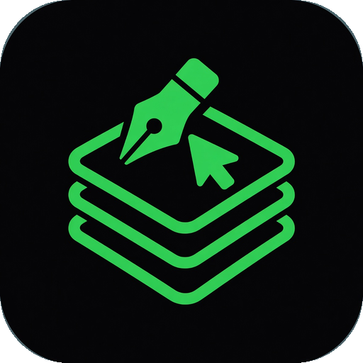
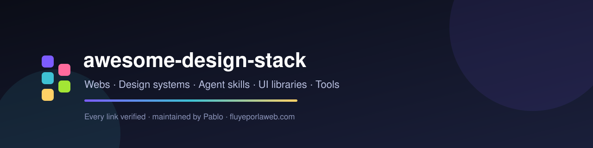

  

<h1 align="center">awesome-design-stack</h1>

<strong>English</strong> &#183; <a href="README.es.md">Español</a>

  
  
  
  

> A curated collection of **web design resources** for people who ship: **landing page and pricing inspiration**, onboarding and empty states, **design systems**, **React and Tailwind components**, typography, icons, motion and shaders, **email design**, accessibility and **AI design tools**. Every link is verified, and the whole list is re-checked weekly, in English and Spanish.

The big design lists went stale years ago, while the work moved on: you pick a design system, drop a `DESIGN.md` into your repo so your coding agent designs like a senior, and grab components instead of reinventing them. One list for the whole stack, maintained by [fluyeporlaweb](https://fluyeporlaweb.com) (Fluye Labs).

## Contents

- [🎨 Inspiration galleries](#inspiration-galleries) (34)
- [🖥️ Galleries by screen type](#galleries-by-screen-type) (13)
- [🧭 UI pattern libraries](#ui-pattern-libraries) (15)
- [🧩 Design systems and guidelines](#design-systems-and-guidelines) (28)
- [🤖 Agent skills for design](#agent-skills-for-design) (19)
- [🧱 UI components and libraries](#ui-components-and-libraries) (45)
- [📄 Templates and UI kits](#templates-and-ui-kits) (16)
- [🌈 Color](#color) (24)
- [✍️ Typography](#typography) (26)
- [🔖 Icons](#icons) (28)
- [🖼️ Illustrations](#illustrations) (17)
- [📸 Stock photos, video and 3D](#stock-photos-video-and-3d) (20)
- [🎞️ Animation and motion](#animation-and-motion) (21)
- [🧪 CSS generators and backgrounds](#css-generators-and-backgrounds) (28)
- [✏️ Prototyping and design tools](#prototyping-and-design-tools) (17)
- [🪄 AI design tools](#ai-design-tools) (17)
- [📧 Email design and tooling](#email-design-and-tooling) (6)
- [📚 Learning, UX and accessibility](#learning-ux-and-accessibility) (33)
- [🧰 Utilities](#utilities) (20)
- [Contributing](#contributing)
- [License](#license)

## 🎨 Inspiration galleries

Real websites to steal structure from (never pixels, always patterns).

- [Land-book](https://land-book.com) - Hand-picked landing pages and web designs, filterable by industry and UI element.
- [Lapa Ninja](https://www.lapa.ninja) - Huge free gallery of landing pages, filterable by element, color and style, plus free UI kits.
- [Awwwards](https://www.awwwards.com) - The awards for the best web design on the planet; winners, nominees and jury notes.
- [CSS Design Awards](https://www.cssdesignawards.com) - Website awards and gallery with honors for UI, UX and innovation.
- [The FWA](https://thefwa.com) - Digital design awards since 2000; every entry gets a written critique.
- [Httpster](https://httpster.net) - Showcase of craft-led, unpretentious websites.
- [Curated Design](https://curated.design) - Award-worthy web design, hand-picked and filterable by style and tag.
- [One Page Love](https://onepagelove.com) - Gallery of one-page websites, with templates and landing page breakdowns.
- [Minimal Gallery](https://minimal.gallery) - Minimalist website designs, curated weekly.
- [Landingfolio](https://www.landingfolio.com) - Landing page inspiration with screenshots of each section you can reuse.
- [Cosmos](https://www.cosmos.so) - Visual discovery and moodboards to save inspiration as you browse.
- [Recent.design](https://recent.design) - What the web looks like right now: fresh site designs added daily.
- [Dark Mode Design](https://www.darkmodedesign.com) - Curated gallery of dark-mode websites and interfaces.
- [Dark Design](https://www.dark.design) - Hand-picked dark-themed websites, from designers for designers.
- [Dribbble](https://dribbble.com/shots) - Where designers post their shots; still the fastest style reference there is.
- [Web Design Inspiration](https://www.webdesign-inspiration.com) - Thousands of live websites grouped by type, style and industry.
- [SaaS Landing Page](https://www.saaslandingpage.com) - Landing pages of SaaS products, organized by category.
- [Call To Idea](https://www.calltoidea.com) - Old-school but handy: quick real examples of buttons, forms, footers and cards.
- [Footer Design](https://footer.design) - A whole gallery of footers, the part everyone designs last and worst.
- [Best Website Gallery](https://bestwebsite.gallery) - The former CSSDA gallery: clean, tagged and searchable.
- [CSS Winner](https://www.csswinner.com) - Website awards and gallery, with a designer eye for detail.
- [Design Nominees](https://www.designnominees.com) - Nominated and awarded websites, apps and games.
- [CSSFox](https://cssfox.co) - Showcase where developers and agencies get their web work scored and awarded.
- [Web Design File](https://www.webdesignfile.com) - A filing cabinet of notable websites, sorted by type and color.
- [Abduzeedo](https://abduzeedo.com) - Daily design inspiration and tutorials, running since 2006.
- [SiteInspire](https://www.siteinspire.com) - Curated gallery of website designs with filters by style, industry and color, useful for briefs and moodboards (`Free`).
- [Behance](https://www.behance.net) - Portfolio network where designers publish case studies and visual work, useful for studying layout and craft (`Free`).
- [Brutalist Websites](https://brutalistwebsites.com) - Directory of raw, unconventional websites that challenge layout conventions and help explore alternative visual directions (`Free`).
- [Design Spells](https://www.designspells.com) - Collection of design references and tutorials that helps turn visual ideas into practical interface decisions (`Free`).
- [SaaSPo](https://saaspo.com) - Browse SaaS landing pages and product screenshots to compare positioning, structure and copy patterns (`Free`).
- [SiteSee](https://sitesee.co) - Curated examples of modern websites organized by industry, useful for research before starting a redesign (`Free`).
- [Scrnshts](https://www.scrnshts.club) - Gallery of website screenshots that makes it quick to scan layouts, colors and typography across many sites (`Free`).
- [Maxibestof](https://maxibestof.one) - Reference site collecting landing pages and interfaces, with quick previews for visual research (`Free`).
- [Landings.dev](https://landings.dev) - Landing page examples grouped by pattern, useful for checking structure and calls to action before designing (`Free`).

## 🖥️ Galleries by screen type

The cure for "another site that looks AI-made": hundreds of real examples of the exact screen you are designing - emails, pricing, 404, onboarding, empty states. Pass them to your agent before it improvises.

- [Checklist Design](https://www.checklist.design) - Checklists of what every page type needs: home, pricing, 404, onboarding.
- [SaaSFrame](https://www.saasframe.io) - Screens and flows from real SaaS products: onboarding, pricing, settings, emails.
- [Really Good Emails](https://www.reallygoodemails.com) - The biggest library of real email design, browsable by type and brand.
- [Good Email Copy](https://www.goodemailcopy.com) - Email copy snippets from real companies, sorted by situation.
- [Email Love](https://emaillove.com) - Hand-picked email design from real products, with a breakdown of each one.
- [Pricing Pages](https://pricingpages.com) - Pricing pages from SaaS products, one per day.
- [Empty States](https://emptystat.es) - The classic collection of empty state examples worth copying.
- [User Onboard](https://www.useronboard.com) - Samuel Hulick tearing down famous onboarding flows, screen by screen.
- [GoodUI](https://www.goodui.org) - UI patterns with receipts: which variant converted better, and by how much.
- [Screenlane](https://screenlane.com) - Screen-by-screen gallery of real products that helps map onboarding flows and in-app patterns (`Freemium`).
- [UX Archive](https://uxarchive.com) - Library of real user flows, organized by product and task, for studying how interfaces guide people (`Free`).
- [Milled](https://milled.com) - Email gallery tracking campaigns from many brands, useful for studying subject lines, layout and cadence (`Free`).
- [404s Design](https://www.404s.design) - Gallery of custom error pages that helps treat 404 screens as part of the product experience (`Free`).

## 🧭 UI pattern libraries

Searchable libraries of real UI patterns: navigation, forms, flows, data viz.

- [Refero](https://refero.design) - Search real screens from top web and mobile products by keyword.
- [Mobbin](https://mobbin.com) - iOS, Android and web screens from real apps and sites; flows and patterns included.
- [Pttrns](https://www.pttrns.com) - Mobile and web patterns, categorized by screen type and element.
- [UI Garage](https://www.uigarage.net) - Web UI patterns by category: forms, tables, onboarding, footers, navbars.
- [Page Flows](https://pageflows.com) - Full user-flow videos (signup, onboarding, upgrade) from famous products.
- [Nicely Done](https://nicelydone.club) - Real screenshots of well-designed SaaS flows.
- [NavNav](https://navnav.co) - Every kind of navigation pattern, with live previews and code.
- [Hover Stat.es](https://hoverstat.es) - A gallery of hover states and microinteractions worth stealing.
- [Collect UI](https://collectui.com) - Daily UI challenges solved by designers, searchable by element.
- [UI Patterns](https://ui-patterns.com) - Pattern library that explains the UX reasoning behind each pattern.
- [Dataviz Catalogue](https://datavizcatalogue.com) - Every data visualization method, explained and compared.
- [From Data to Viz](https://www.data-to-viz.com) - Pick the right chart by picking the shape of your data; caveats included.
- [The Component Gallery](https://component.gallery) - Searchable collection of UI components from live websites, organized by pattern for design research (`Free`).
- [UX Patterns for Devs](https://uxpatterns.dev) - Practical patterns for common interface problems, with code-oriented explanations for designers and developers (`Free`).
- [Design Vault](https://www.designvault.io) - Library of interface examples and design resources that supports research, moodboards and team reference (`Freemium`).

## 🧩 Design systems and guidelines

How the big teams do it: tokens, components and rules you can borrow.

- [Material 3](https://m3.material.io) - Google's open-source design system; tokens, components and guidance for web and apps.
- [Apple Human Interface Guidelines](https://developer.apple.com/design/human-interface-guidelines/) - Apple's HIG; a reference for interface quality far beyond Apple platforms.
- [Fluent 2](https://fluent2.microsoft.design) - Microsoft's cross-platform design system.
- [Carbon Design System](https://carbondesignsystem.com) - IBM's open-source design system for products and digital experiences.
- [Polaris](https://polaris.shopify.com) - Shopify's design system, with strong commerce and admin-UI patterns.
- [Atlassian Design System](https://atlassian.design) - Components and guidelines behind Jira, Confluence and the Atlassian suite.
- [Primer](https://primer.style) - GitHub's design system, with docs and React components.
- [Spectrum](https://spectrum.adobe.com) - Adobe's design system for its professional apps and web products.
- [Lightning Design System](https://www.lightningdesignsystem.com) - Salesforce's design system and a huge component reference.
- [PatternFly](https://www.patternfly.org) - Red Hat's open design system for enterprise interfaces.
- [Pajamas](https://design.gitlab.com) - GitLab's design system: components, content guidelines and research methods.
- [Backpack](https://backpack.github.io) - Skyscanner's design system for travel products.
- [Elastic UI Framework](https://eui.elastic.co/) - The component library that powers Kibana.
- [Nord](https://nordhealth.design) - Nordhealth's accessible design system for healthcare products.
- [U.S. Web Design System](https://designsystem.digital.gov) - The US government design system; a model of accessible, sober UI.
- [UNDP Design System](https://design.undp.org) - UNDP's global design system for its digital products and content.
- [Design Systems Repo](https://designsystemsrepo.com) - Directory of design systems by company, plus articles and community.
- [DesignSystems.com](https://www.designsystems.com) - Community hub for design systems: articles, examples and jobs.
- [Open UI](https://open-ui.org) - Community research on making UI components work the same across frameworks.
- [Cloudscape](https://cloudscape.design) - Design system with components and guidelines for building cloud console interfaces consistently (`Open Source`).
- [Paste](https://paste.twilio.design) - Design system from Twilio that gives product teams tokens, components and guidance for consistent interfaces (`Open Source`).
- [Base Web](https://baseweb.design) - React component library and design system that helps teams build interfaces with shared styling rules (`Open Source`).
- [Evergreen](https://evergreen.segment.com) - Component library for React that covers common interface needs and keeps styling consistent across products (`Open Source`).
- [Blueprint](https://blueprintjs.com) - React UI toolkit aimed at data-heavy desktop applications, with components and interaction patterns included (`Open Source`).
- [Gestalt](https://gestalt.pinterest.systems) - Pinterest's design system, with components and foundations for building accessible product interfaces (`Open Source`).
- [GOV.UK Design System](https://design-system.service.gov.uk) - Design system for public services, with research-backed patterns and accessible components for teams building public websites (`Open Source`).
- [Semi Design](https://semi.design) - Component library and design system that helps product teams ship consistent interfaces across platforms (`Open Source`).
- [Orbit](https://github.com/kiwicom/orbit) - Design system from Kiwi.com with components and guidelines for building travel booking interfaces (`Open Source`).

## 🤖 Agent skills for design

Make Claude, Cursor or opencode design like a senior: `DESIGN.md` files, rules and skill libraries.

- [anthropics/skills](https://github.com/anthropics/skills) - Anthropic's official skills repo; reference implementations to learn from.
- [taste-skill](https://github.com/Leonxlnx/taste-skill) - Agent skills that give coding agents taste: art direction, reference images and a browser check instead of generic AI pages.
- [awesome-design-md](https://github.com/VoltAgent/awesome-design-md) - DESIGN.md files distilled from well-known brand design systems; drop one into your project so your agent designs like that brand.
- [awesome-claude-design](https://github.com/VoltAgent/awesome-claude-design) - Ready-to-use design system inspirations in DESIGN.md format for Claude and other agents.
- [awesome-design-skills](https://github.com/bergside/awesome-design-skills) - DESIGN.md and SKILL.md design skill files for Claude, Cursor and other agentic tools.
- [awesome-claude-skills](https://github.com/ComposioHQ/awesome-claude-skills) - The big curated list of Claude skills, resources and tools.
- [awesome-claude-code](https://github.com/hesreallyhim/awesome-claude-code) - The best resources for Claude Code: plugins, CLAUDE.md examples and workflows.
- [awesome-cursorrules](https://github.com/PatrickJS/awesome-cursorrules) - .cursorrules and rules files for Cursor, organized by stack.
- [awesome-shadcn-ui](https://github.com/birobirobiro/awesome-shadcn-ui) - Everything shadcn/ui: templates, plugins and component registries built on top of it.
- [superpowers](https://github.com/obra/superpowers) - A library of agent skills that give Claude Code expert workflows and process discipline.
- [good-css](https://github.com/vojtaholik/good-css) - Opinionated modern CSS techniques as an agent skill, each with a live specimen.
- [diagram-design](https://github.com/cathrynlavery/diagram-design) - Editorial diagram design for coding agents: 52 diagram types as self-contained HTML.
- [LottieFiles motion-design-skill](https://github.com/LottieFiles/motion-design-skill) - Motion design principles for agents: timing, easing and choreography, adapted for UI.
- [motion-dev-animations-skill](https://github.com/199-biotechnologies/motion-dev-animations-skill) - A Claude skill for Motion.dev: springs, scroll effects and gesture interactions.
- [GSAP skills](https://github.com/greensock/gsap-skills) - GSAP's official skills, teaching agents how to use it correctly.
- [Vercel skills CLI](https://github.com/vercel-labs/skills) - The open agent skills tool (`npx skills`) to install and manage skills in any project.
- [opencode](https://opencode.ai) - Open-source terminal coding agent with skills support; a solid base for a design agent stack.
- [AnimatedWebs](https://animatedwebs.com) - Prompts for animated web designs (WebGL, shaders, scroll), with an MCP server your agent can query.
- [Superdesign](https://superdesign.dev) - An AI design agent that turns prompts into UI mockups, screens and components.

## 🧱 UI components and libraries

Grab components instead of reinventing them: headless primitives, styled sets, animated ones.

- [shadcn/ui](https://ui.shadcn.com) - Copy-paste components built on Radix and Tailwind; the de facto standard of modern app UI.
- [Radix Primitives](https://github.com/radix-ui/primitives) - Unstyled, accessible React primitives to compose into your own design system.
- [Radix Colors](https://www.radix-ui.com/colors) - Perceptually uniform color scales calibrated for accessibility.
- [Headless UI](https://github.com/tailwindlabs/headlessui) - Unstyled accessible React and Vue components from the Tailwind team.
- [Base UI](https://base-ui.com) - Unstyled, accessible components from the MUI team, designed to be styled.
- [Melt UI](https://melt-ui.com) - Headless Svelte component builders, the Svelte answer to Radix.
- [Bits UI](https://www.bits-ui.com) - Headless Svelte-5 components designed to pair with Tailwind.
- [shadcn-svelte](https://shadcn-svelte.com) - The shadcn/ui concept ported to Svelte.
- [daisyUI](https://github.com/saadeghi/daisyui) - Tailwind plugin with semantic component classes; fast UI without writing utilities.
- [Magic UI](https://github.com/magicuidesign/magicui) - Copy-paste animated components and effects designed for shadcn/Tailwind.
- [Aceternity UI](https://ui.aceternity.com) - Copy-paste components with heavy motion, the ones behind all those hero sections.
- [Inspira UI](https://inspiraui.com) - Animated components in the shadcn style, for Vue and Nuxt.
- [Animata](https://animata.design) - Hundreds of free animated React components, copy-paste with Tailwind.
- [Motion Primitives](https://github.com/ibelick/motion-primitives) - A library of prebuilt motion components for React, on top of Motion.
- [React Bits](https://www.reactbits.dev) - A catalog of animated React components and effects, with code sandboxes.
- [Uiverse](https://uiverse.io) - The largest community library of open-source UI elements, CSS or Tailwind.
- [HeroUI](https://github.com/heroui-inc/heroui) - Fully accessible React components styled with Tailwind (formerly NextUI).
- [Mantine](https://github.com/mantinedev/mantine) - 100+ React components with hooks and dark theme out of the box.
- [Ant Design](https://github.com/ant-design/ant-design) - Enterprise-grade React UI library with a massive component set and design tokens.
- [Chakra UI](https://github.com/chakra-ui/chakra-ui) - Accessible React component system with a great theming API.
- [Material UI](https://mui.com) - The React implementation of Material Design, with a huge ecosystem.
- [Tremor](https://github.com/tremorlabs/tremor) - React components for dashboards and charts, built on Tailwind.
- [Park UI](https://github.com/chakra-ui/park-ui) - Styled components on Ark UI for React, Vue and Solid.
- [Bulma](https://bulma.io) - Flexbox-based CSS framework with readable class names and no JavaScript.
- [Bootstrap](https://getbootstrap.com) - The CSS framework that still ships everywhere; huge docs and ecosystem.
- [Flowbite](https://flowbite.com) - Open-source Tailwind component library, from navbars to charts.
- [Preline](https://preline.co) - Open-source Tailwind components with a Figma file to match.
- [HyperUI](https://www.hyperui.dev) - Free Tailwind components, from hero sections to ecommerce.
- [Meraki UI](https://merakiui.com) - Free Tailwind components with full RTL support.
- [Float UI](https://floatui.com) - Tailwind components and templates with a clean default look.
- [Kibo UI](https://www.kibo-ui.com) - A custom registry of composable, accessible shadcn components.
- [Tailwind Flex](https://tailwindflex.com) - A big community library of Tailwind examples with live previews.
- [Tailgrids](https://tailgrids.com) - Open-source React component library and design system on Tailwind.
- [Tailwind CSS](https://github.com/tailwindlabs/tailwindcss) - The utility-first CSS framework that powers most modern design stacks.
- [21st.dev](https://21st.dev) - Community marketplace of copy-paste React components and UI patterns.
- [Hover.dev](https://hover.dev) - Learn to build real web UI with React, Tailwind and Motion, by building.
- [Origin UI](https://originui.com) - Copyable React and Tailwind components that speed up interface work without setting up a full design system (`Open Source`).
- [Ark UI](https://ark-ui.com) - Unstyled, accessible React components that let teams build custom interfaces on top of solid behavior (`Open Source`).
- [React Aria](https://react-spectrum.adobe.com/react-aria/) - Accessible UI primitives for React that handle keyboard, focus and screen reader behavior for custom components (`Open Source`).
- [Ariakit](https://ariakit.org) - Headless React components with built-in accessibility, useful when you need custom styling and solid interactions (`Open Source`).
- [Open Props](https://open-props.style) - CSS custom property library that supplies design tokens for color, type, spacing and shadows (`Open Source`).
- [Pico CSS](https://picocss.com) - Minimal CSS framework that styles semantic HTML with sensible defaults and very little custom code (`Open Source`).
- [Skeleton](https://skeleton.dev) - Svelte UI toolkit with components and theme variables for building interfaces quickly (`Open Source`).
- [Fancy Components](https://www.fancycomponents.dev) - Animated React components you can drop into a project to add motion without building it from scratch (`Open Source`).
- [Web Awesome](https://webawesome.com) - Open-source web component library that brings ready-made interface primitives to any framework (`Open Source`).

## 📄 Templates and UI kits

Starting points for the parts you should never design from zero.

- [Figma Community](https://www.figma.com/community) - Thousands of free and paid UI kits, mockups and design files from the community.
- [UI Design Daily](https://www.uidesigndaily.com) - A fresh open-source UI resource every day: cards, forms, dashboards.
- [HTML5 UP](https://html5up.net) - Free, responsive HTML5 templates with strong art direction.
- [Start Bootstrap](https://startbootstrap.com) - Free Bootstrap templates and themes, from landing pages to admin panels.
- [Cruip](https://cruip.com) - Startup landing templates for Tailwind, React, Vue and plain HTML.
- [TReact](https://treact.owaiskhan.me) - Free modern React templates for landing pages, built with TailwindCSS.
- [Windy Toolbox](https://windytoolbox.com) - Tailwind starter templates, components and generators (formerly Tailwind Toolbox).
- [Tailwind Templates](https://tailwindtemplates.io) - Free Tailwind templates and components with instant preview.
- [Tailwind Kit](https://www.tailwind-kit.com) - A library of Tailwind components and sections, in Vue 3.
- [Free Frontend](https://freefrontend.com) - Thousands of free frontend assets: CSS, JavaScript, React, Tailwind.
- [Tailwind UI](https://tailwindui.com) - Ready-made component and page examples built with Tailwind, useful for assembling product interfaces faster (`Freemium`).
- [Creative Tim](https://www.creative-tim.com) - Admin templates and UI kits that give teams a starting point for dashboards and product screens (`Freemium`).
- [ThemeWagon](https://themewagon.com) - Free website templates for common project types, useful as a starting point for design and prototypes (`Free`).
- [Templatemo](https://templatemo.com) - HTML and CSS templates for landing pages and sites, handy for quick prototypes and layout reference (`Free`).
- [Vercel Templates](https://vercel.com/templates) - Starter projects from Vercel that show how to combine frameworks, deployment and common app patterns (`Free`).
- [Sailboat UI](https://sailboatui.com) - Open-source component collection for building interfaces with consistent styling and ready-made building blocks (`Open Source`).

## 🌈 Color

Palettes, generators and contrast tools that keep the result accessible.

- [Coolors](https://coolors.co) - The fastest palette generator around; trending palettes, contrast checker and more tools.
- [Realtime Colors](https://www.realtimecolors.com) - Visualize palettes, fonts and styles on a real landing page, live.
- [Happy Hues](https://www.happyhues.com) - Curated palettes shown applied to a real site, with hex codes and usage notes.
- [Color Hunt](https://colorhunt.co) - Trending hand-picked palettes, refreshed daily.
- [Adobe Color](https://color.adobe.com) - Color wheel with harmony rules, extraction from images and accessibility tools.
- [UI Colors](https://uicolors.app) - Generate a full set of Tailwind color shades from a single hex.
- [Colorbox](https://colorbox.io) - Lyft's tool to build accessible color scales from one base color.
- [Accessible Palette](https://accessiblepalette.com) - Generate UI color palettes with even perceptual lightness, by Rauno Freiberg.
- [Leonardo](https://leonardocolor.io) - Generate colors by desired contrast ratio; made by Adobe for adaptive themes.
- [WhoCanUse](https://www.whocanuse.com) - Check a color pair against simulated vision deficiencies and real displays.
- [Contrast Ratio](https://www.siegemedia.com/contrast-ratio) - Lea Verou's one-input contrast checker; instant and honest.
- [OKLCH Color Picker](https://oklch.com) - Pick colors in OKLCH, the perceptual color space that plays well with CSS.
- [Khroma](https://www.khroma.co) - A palette generator trained on the colors you like.
- [Huemint](https://huemint.com) - Generates color schemes for specific contexts: websites, brands, gradients.
- [Eva Colors](https://colors.eva.design) - Deep-learning palette generator that balances your primary color.
- [Paletton](https://paletton.com) - The classic color wheel for building complementary palettes.
- [Pigment by Shapefactory](https://pigment.shapefactory.co) - Blend two colors into a gradient and find the palette between them.
- [Colors and Fonts](https://www.colorsandfonts.com) - Color palettes and font pairings side by side, by Michael Andreuzza.
- [Culrs](https://culrs.com) - Hundreds of curated palettes, searchable by mood and tone.
- [RandomA11y](https://randoma11y.com) - An endless feed of random, but always accessible, color combinations.
- [tints.dev](https://www.tints.dev) - Tool for exploring color tints and shades, useful for building palettes that stay consistent across a design (`Free`).
- [hue.tools](https://hue.tools) - Small color utilities for adjusting hue and generating palettes during early design exploration (`Free`).
- [MyColor.space](https://mycolor.space) - Palette generator that turns one color into schemes you can test quickly in interface mockups (`Free`).
- [Accessible Colors](https://accessible-colors.com) - Palette checker that tests color combinations against contrast guidelines before you ship them (`Free`).

## ✍️ Typography

Where to find fonts, how to pair them and how to scale them.

- [Google Fonts](https://fonts.google.com) - The library of free web fonts, filterable by use case and language.
- [Fontsource](https://fontsource.org) - Self-host Google Fonts as npm packages, without external requests.
- [Fontshare](https://www.fontshare.com) - Free professional typefaces from the Indian Type Foundry, with an API.
- [Typewolf](https://www.typewolf.com) - Font recommendations and pairings spotted on real sites.
- [Fonts In Use](https://fontsinuse.com) - An archive of real-world typography by industry and format.
- [Fontpair](https://www.fontpair.co) - Google Fonts pairings, browsable by style.
- [Fontjoy](https://fontjoy.com) - Generate font pairings with deep learning and lock the ones you like.
- [Utopia](https://utopia.fyi) - Fluid type and space scales that stretch smoothly between breakpoints.
- [Type Scale](https://typescale.com) - Visual modular type scale calculator with px/rem/em output.
- [Fluid Type Scale](https://www.fluid-type-scale.com) - Generate clamp()-based fluid typography without the algebra.
- [Modular Scale](https://www.modularscale.com) - Tim Brown's calculator for building scales on a meaningful ratio.
- [Free Faces](https://www.freefaces.gallery) - A browsable gallery of free typefaces, chosen with taste.
- [V-Fonts](https://v-fonts.com) - Find and try variable fonts in the browser.
- [Font Squirrel](https://www.fontsquirrel.com) - Free fonts, hand-reviewed and licensed for commercial use.
- [The League of Moveable Type](https://www.theleagueofmoveabletype.com) - The original open-source type foundry; home of League Gothic.
- [Open Font Library](https://fontlibrary.org) - Open-licensed fonts, searchable and downloadable for any use.
- [Velvetyne](https://velvetyne.fr) - Open-source display typefaces from a French foundry collective.
- [Inter](https://rsms.me/inter/) - Rasmus' UI typeface family designed for computer screens, variable axes included.
- [JetBrains Mono](https://www.jetbrains.com/lp/mono/) - A free mono typeface built for developers, with ligatures and tall x-height.
- [Monaspace](https://monaspace.githubnext.com) - GitHub's variable superfamily of five mono fonts with texture healing.
- [Fonts Bunny](https://fonts.bunny.net) - Google Fonts served from a privacy-first European proxy.
- [typ.io](https://typ.io) - Typeface pairing reference drawn from real websites, useful when choosing font combinations for a project (`Free`).
- [Modern Font Stacks](https://modernfontstacks.com) - System font stacks that avoid webfont downloads while keeping text readable across platforms (`Free`).
- [IBM Plex](https://www.ibm.com/plex) - Open type family with several scripts and styles, built for clear, consistent communication across products (`Open Source`).
- [Recursive](https://www.recursive.design) - Variable font that moves between casual and monospaced styles, useful for code and interface text (`Open Source`).
- [Uncut](https://uncut.wtf) - Font sampler for previewing typefaces with your own text before deciding on a typographic direction (`Free`).

## 🔖 Icons

Complete, consistent icon sets with packages for your stack.

- [Lucide](https://lucide.dev) - Open-source icons with a consistent stroke, packaged for every framework.
- [Heroicons](https://heroicons.com) - Hand-drawn SVG icons by the Tailwind makers, in outline, solid and mini.
- [Phosphor](https://phosphoricons.com) - One icon family in six weights, available for all frameworks.
- [Iconify](https://iconify.design) - One framework for 200,000+ icons from every major set, on demand.
- [Icones](https://icones.js.org) - Search all Iconify collections and copy as SVG or component.
- [Tabler Icons](https://tabler.io/icons) - Thousands of MIT stroke-based SVG icons, all consistent.
- [Feather Icons](https://feathericons.com) - Simply beautiful, consistent open-source icons.
- [Remix Icon](https://remixicon.com) - Nearly 3,000 icons in two styles, designed by the Remix team.
- [Boxicons](https://boxicons.com) - 1,500+ carefully crafted icons in three variants.
- [Iconoir](https://iconoir.com) - A growing family of 1,500+ icons, with React and React Native libraries.
- [css.gg](https://css.gg) - 700+ UI icons done in pure CSS, no SVG files.
- [Pictogrammers](https://pictogrammers.com) - The home of Material Design Icons and its huge community set.
- [Material Symbols](https://fonts.google.com/icons) - Google's current icon set as a variable font: weight, grade, fill.
- [Simple Icons](https://simpleicons.org) - SVG logos of every major brand, with packages for npm and CMSs.
- [Akar Icons](https://akaricons.com) - A perfectly rounded set of 150+ icons, free for anything.
- [Zondicons](https://www.zondicons.com) - A small free set of 20 icons by Steve Schoger.
- [Untitled UI Icons](https://www.untitledui.com/free-icons) - A starter pack of 1,300+ icons matching the Untitled UI style.
- [3dicons](https://3dicons.co) - 1,440+ open-source 3D icons rendered at four angles, no attribution needed.
- [Lordicon](https://lordicon.com) - Animated icons, ready as Lottie, GIF or JSON.
- [The Noun Project](https://thenounproject.com) - The classic marketplace of icons for every concept you can name.
- [Icons8](https://icons8.com) - Icons, illustrations and photos in every style, with free tier and apps.
- [SVG Repo](https://www.svgrepo.com) - 500,000+ open-licensed SVG icons and vectors, searchable.
- [Font Awesome](https://fontawesome.com) - Large icon set with consistent styling, used to add recognizable symbols to interfaces and documents (`Freemium`).
- [Bootstrap Icons](https://icons.getbootstrap.com) - Open icon library that matches Bootstrap's visual language and works in any web project (`Open Source`).
- [Ionicons](https://ionic.io/ionicons) - Open-source icon set with several styles, made to cover common interface needs across platforms (`Open Source`).
- [React Icons](https://react-icons.github.io/react-icons/) - Package that gathers popular icon sets as React components, simplifying import and use in apps (`Open Source`).
- [Fluent UI System Icons](https://github.com/microsoft/fluentui-system-icons) - Microsoft icon collection with consistent weights and styles for product interfaces and documentation (`Open Source`).
- [Hugeicons](https://hugeicons.com) - Icon library with multiple styles and sizes for teams that need a wide visual vocabulary in products (`Freemium`).

## 🖼️ Illustrations

Open-source and free illustrations you can recolor to your brand.

- [unDraw](https://undraw.co) - Open-source SVG illustrations, recolorable to your brand, no attribution needed.
- [Storyset](https://storyset.com) - Edit and animate illustrated concepts, from the Freepik family.
- [Open Doodles](https://www.opendoodles.com) - Free doodles by Pablo Stanley; use, recolor, animate, sell.
- [Humaaans](https://www.humaaans.com) - Mix-and-match people illustrations in SVG.
- [Open Peeps](https://www.openpeeps.com) - Hand-drawn characters you can compose in CSS or SVG.
- [DrawKit](https://www.drawkit.com) - Free and pro SVG illustration packs, editable in Figma and Illustrator.
- [Blush](https://blush.design) - Customize illustration collections from artists worldwide; free plan available.
- [Illlustrations](https://illlustrations.co) - 120+ free illustrations for anything, CC0.
- [Lukasz Adam Illustrations](https://lukaszadam.com/illustrations) - Free MIT-licensed vector illustrations, updated weekly.
- [CocoMaterial](https://cocomaterial.com) - An open-source library of hand-drawn illustrations and patterns.
- [IRA Design](https://iradesign.io) - Build your own gradient-styled illustrations, by Creative Tim.
- [Pixeltrue Illustrations](https://www.pixeltrue.com/packs) - Illustration and animation packs, free for personal and commercial use.
- [Absurd Design](https://absurd.design) - Surreal illustration collection that helps add a distinctive visual tone to landing pages and editorial layouts (`Freemium`).
- [Popsy](https://popsy.co) - Illustration library with editable scenes, useful for adding character to product pages without custom drawing (`Free`).
- [DiceBear](https://www.dicebear.com) - Avatar generator that creates consistent profile illustrations from names or seeds for apps and prototypes (`Open Source`).
- [Shapefest](https://www.shapefest.com) - Collection of abstract shapes and graphics to add texture and rhythm to compositions and presentations (`Free`).
- [Avataaars](https://getavataaars.com) - Avatar generator with adjustable features for adding illustrated people to profiles, demos and prototypes (`Open Source`).

## 📸 Stock photos, video and 3D

Free photos, videos and 3D assets, mostly CC0, for real pages.

- [StockSnap](https://www.stocksnap.io) - Free high-resolution photos under CC0, searchable by tag.
- [Kaboompics](https://kaboompics.com) - Warm lifestyle photos, free for commercial use, with matching palettes.
- [Negative Space](https://negativespace.co) - Free stock photos with generous copy space, CC0.
- [Life of Pix](https://www.lifeofpix.com) - High-resolution free photos from photographers around the world.
- [Gratisography](https://gratisography.com) - Ryan McGuire's weird and wonderful free photos.
- [Iso Republic](https://isorepublic.com) - Thousands of free high-resolution photos and videos.
- [SplitShire](https://www.splitshire.com) - Royalty-free photos and videos with a more human feel.
- [Freestocks](https://freestocks.org) - Free stock photos for commercial use, no strings attached.
- [Magdeleine](https://magdeleine.co) - A daily hand-picked photo, CC0 and public domain.
- [Shopify Stock Photos](https://www.shopify.com/stock-photos) - Thousands of free photos aimed at commerce and products.
- [Coverr](https://coverr.co) - Free stock videos and music for hero sections.
- [Mixkit](https://mixkit.co) - Free video clips, motion graphics and sound effects, by Envato.
- [Poly Pizza](https://poly.pizza) - Thousands of free low-poly 3D models, including Google Poly survivors.
- [Quaternius](https://quaternius.com) - Free stylized 3D asset packs, from low-poly cities to animated characters.
- [Poly Haven](https://polyhaven.com) - CC0 HDRIs, textures and 3D models, community run.
- [Sketchfab](https://sketchfab.com) - The place to publish and find 3D models, with thousands downloadable.
- [Pexels](https://www.pexels.com) - Stock photo and video library with searchable subjects, used to illustrate pages and prototypes quickly (`Free`).
- [Pixabay](https://pixabay.com) - Stock media library with photos, vectors and video, useful for finding visuals for mockups and content (`Free`).
- [Nappy](https://www.nappy.co) - Photo library focused on authentic people and everyday scenes, useful for inclusive visual storytelling (`Free`).
- [FoodiesFeed](https://www.foodiesfeed.com) - Food photo library organized by ingredient and dish, useful for menus, recipe pages and mockups (`Free`).

## 🎞️ Animation and motion

Libraries and tools to move the interface without drowning in JavaScript.

- [GSAP](https://gsap.com) - The professional animation platform for the web; scroll, SVG, timelines.
- [Motion](https://motion.dev) - The animation library for React and vanilla JS, formerly Framer Motion.
- [LottieFiles](https://lottiefiles.com) - Thousands of Lottie animations plus tools to ship them anywhere.
- [Rive](https://rive.app) - Interactive animated graphics that run at 60fps everywhere, from app to web.
- [Jitter](https://jitter.video) - Design animated content in the browser, Figma-style, and export video.
- [anime.js](https://animejs.com) - A small but mighty animation library for CSS, SVG and JS objects.
- [Theatre.js](https://www.theatrejs.com) - Animate anything in the browser with a real editor and keyframes.
- [Auto-Animate](https://auto-animate.formkit.com) - One line of code to get smooth transitions when the DOM changes.
- [Three.js](https://threejs.org) - JavaScript library for rendering 3D scenes in the browser, used for product views and interactive visuals (`Open Source`).
- [React Three Fiber](https://r3f.docs.pmnd.rs) - React renderer for Three.js that lets teams build 3D scenes with components and reusable state (`Open Source`).
- [Shadertoy](https://www.shadertoy.com) - Community gallery of GLSL shaders with live previews, useful for studying effects and procedural graphics (`Free`).
- [The Book of Shaders](https://thebookofshaders.com) - Step-by-step guide to fragment shaders that explains GPU graphics concepts through practical examples (`Free`).
- [Paper Shaders](https://shaders.paper.design) - Ready-to-use shader pack for React that adds gradients and animated backgrounds to web interfaces (`Open Source`).
- [Shader Gradient](https://www.shadergradient.co) - Tool for generating gradient shader backgrounds and exporting them into design and code workflows (`Free`).
- [Unicorn Studio](https://www.unicorn.studio) - Visual editor for interactive 3D and WebGL scenes, used to embed motion graphics without hand-coding shaders (`Freemium`).
- [Lenis](https://lenis.darkroom.engineering) - Smooth scrolling library that normalizes scroll behavior across browsers and devices in web projects (`Open Source`).
- [React Spring](https://www.react-spring.dev) - Spring-based animation library for React that handles transitions and motion with natural-looking physics (`Open Source`).
- [PixiJS](https://pixijs.com) - Browser-based 2D rendering engine that supports sprites, filters and interactive graphics in web apps (`Open Source`).
- [Babylon.js](https://www.babylonjs.com) - Web rendering engine for 3D scenes and games, with tools for lighting, physics and interaction (`Open Source`).
- [Transition.css](https://www.transition.style) - Small library of CSS transitions that you can drop into a project for quick motion on common elements (`Open Source`).
- [CSS Loaders](https://css-loaders.com) - Collection of CSS loading indicators to copy into interfaces while content or data is still arriving (`Free`).

## 🧪 CSS generators and backgrounds

Copy-paste generators for gradients, patterns, shadows, grids and dividers.

- [Animista](https://animista.net) - Play with CSS animations, tweak them and copy the code.
- [Animate.css](https://github.com/animate-css/animate.css) - Ready-to-use cross-browser CSS animations, one class each.
- [cubic-bezier](https://cubic-bezier.com) - Interactive cubic-bezier easing editor.
- [Easings](https://easings.net) - Cheat sheet of easing functions with live demos.
- [CSS Gradient](https://cssgradient.io) - Gradient generator with copy-paste CSS and honest tutorials.
- [Gradient Magic](https://www.gradientmagic.com) - A huge gallery of one-of-a-kind CSS gradients.
- [Mesh Gradient](https://meshgradient.in) - Generate and export mesh gradients as PNG, for free.
- [Trianglify](https://trianglify.io) - Low-poly triangle pattern generator for backgrounds.
- [Shape Dividers](https://www.shapedividers.com) - Custom SVG section dividers, generated visually.
- [Haikei](https://haikei.app) - SVG generators for blobs, waves, gradients and low-poly backgrounds.
- [fffuel](https://www.fffuel.co) - Illustration, color and SVG asset generators in one place.
- [Belick Backgrounds](https://bg.ibelick.com) - Modern background generator (grids, dots, gradients) that outputs Tailwind.
- [Hero Patterns](https://heropatterns.com) - Steve Schoger's repeatable SVG patterns, recolorable in a click.
- [pattern.css](https://bansal.io/pattern-css) - Fill empty backgrounds with CSS-only patterns, no images.
- [Transparent Textures](https://transparenttextures.com) - Subtle noise and texture overlays, copy as CSS.
- [Subtle Patterns](https://www.toptal.com/designers/subtlepatterns/) - The classic archive of subtle, tileable background textures.
- [SVG Backgrounds](https://www.svgbackgrounds.com) - Customize SVG backgrounds and patterns, export as SVG or CSS.
- [Magic Pattern](https://www.magicpattern.com) - Mesh gradients, blobs, stripes and dividers, each with a generator.
- [Blobmaker](https://www.blobmaker.app) - Make organic SVG blobs in seconds, with size and complexity controls.
- [Get Waves](https://getwaves.io) - Generate SVG waves and use them as section dividers.
- [CSSmatic](https://www.cssmatic.com) - Free CSS generators plus a beginner-to-mastery course.
- [Neumorphism.io](https://neumorphism.io) - Soft-UI (neumorphism) CSS generator.
- [Glassmorphism](https://glassmorphism.com) - Frosted-glass effect generator with copy-paste CSS.
- [css-doodle](https://css-doodle.com) - Draw generative art with a web component and plain CSS.
- [CSS Grid Generator](https://cssgrid-generator.netlify.app) - Draw a grid, get the CSS.
- [Layoutit Grid](https://grid.layoutit.com) - Interactive CSS grid builder with templates and live preview.
- [doodad.dev](https://doodad.dev) - Generator for CSS patterns and backgrounds that turns a few settings into reusable decorative styles (`Free`).
- [Fancy Border Radius](https://9elements.github.io/fancy-border-radius/) - Interactive tool for shaping unusual border radii and copying the resulting CSS into a project (`Free`).

## ✏️ Prototyping and design tools

From quick wireframes to full design tools, including the free ones.

- [Figma](https://www.figma.com) - The standard for UI design, prototyping and collaboration.
- [Penpot](https://penpot.app) - Open-source design and prototyping platform; the self-hostable Figma alternative.
- [Framer](https://www.framer.com) - Design and publish real sites with motion built in.
- [Sketch](https://www.sketch.com) - The macOS design tool, with a mature ecosystem.
- [Excalidraw](https://excalidraw.com) - Hand-drawn-style whiteboard, free and open-source.
- [tldraw](https://www.tldraw.com) - Infinite collaborative canvas with an open-source SDK.
- [Whimsical](https://whimsical.com) - Fast wireframes, flowcharts and mind maps.
- [Balsamiq](https://balsamiq.com) - Low-fidelity wireframes that stay deliberately sketchy.
- [Mockflow](https://mockflow.com) - Wireframing and planning suite with lots of ready components.
- [Zeplin](https://zeplin.io) - Handoff between design and code: specs, assets and snippets.
- [Spline](https://spline.design) - Design 3D scenes in the browser and ship them to the web.
- [Photopea](https://www.photopea.com) - A full image editor in the browser, free, that opens PSDs.
- [Canva](https://www.canva.com) - Quick graphic design for the 90% of assets that never reach Figma.
- [ProtoPie](https://www.protopie.io) - Prototyping tool for realistic interactions and microtransitions, useful for testing flows before development (`Freemium`).
- [Lunacy](https://icons8.com/lunacy) - Design editor that opens Sketch files and works offline, useful for UI work on desktop (`Freemium`).
- [diagrams.net](https://www.diagrams.net) - Diagram editor for flowcharts and wireframes that runs in the browser or on desktop (`Open Source`).
- [Miro](https://miro.com) - Collaborative whiteboard for workshops, mappings and wireframes, used by distributed product teams (`Freemium`).

## 🪄 AI design tools

Generate interfaces, wireframes and brand art, then fix them by hand.

- [v0](https://v0.app) - Vercel's generative UI: from prompt to React/Tailwind/shadcn interfaces.
- [Google Stitch](https://stitch.google.com) - From prompt or sketch to UI design and frontend code, from Google Labs.
- [Relume](https://www.relume.ai) - AI sitemap and wireframe builder on top of Webflow and Figma.
- [Uizard](https://uizard.io) - From sketch or prompt to mockups, made for non-designers.
- [Recraft](https://www.recraft.ai) - Generate and edit brand-consistent vector art and icons.
- [Krea](https://www.krea.ai) - Generate and enhance images and video in real time, with style training.
- [Ideogram](https://ideogram.ai) - The image model that renders text inside images without gibberish.
- [Kittl](https://www.kittl.com) - Design logos, merch and print with AI built into a real editor.
- [Midjourney](https://www.midjourney.com) - Image generation tool for exploring visual concepts and moodboards from short text prompts (`Freemium`).
- [Black Forest Labs (FLUX)](https://bfl.ai) - Image generation models used to create visual concepts and assets from text descriptions (`Freemium`).
- [Adobe Firefly](https://www.adobe.com/products/firefly.html) - Generative tools integrated with Adobe apps for creating and editing visual assets from prompts (`Freemium`).
- [Leonardo.Ai](https://leonardo.ai) - Image generation workspace for concept art and visual assets, with controls over style and composition (`Freemium`).
- [Motiff](https://www.motiff.com) - Interface design tool that supports duplication detection and design system maintenance for product teams (`Freemium`).
- [Subframe](https://www.subframe.com) - Tool that turns design work into production-ready React and Tailwind code for product teams (`Freemium`).
- [UX Pilot](https://www.uxpilot.ai) - AI assistant for wireframes and UI concepts that helps explore screens early in the design process (`Freemium`).
- [Visily](https://www.visily.ai) - Wireframing tool with templates and AI assistance for sketching product screens without design training (`Freemium`).
- [Locofy](https://www.locofy.ai) - Converter that turns Figma designs into React or HTML components to speed up front-end implementation (`Freemium`).

## 📧 Email design and tooling

Tools and references for designing, building and testing transactional and marketing emails.

- [React Email](https://react.email) - Component library for writing responsive email templates in React, with previews and reusable blocks (`Open Source`).
- [MJML](https://mjml.io) - Markup language that compiles responsive email templates into the table-based HTML mail clients expect (`Open Source`).
- [Maizzle](https://maizzle.com) - Framework for building HTML emails with familiar tooling, reusable components and predictable output (`Open Source`).
- [Can I Email](https://www.caniemail.com) - Compatibility reference that shows which CSS and HTML features work in each email client (`Free`).
- [Litmus](https://www.litmus.com) - Email testing platform for previewing campaigns across clients and checking rendering before sending (`Freemium`).
- [Campaign Monitor CSS](https://www.campaignmonitor.com/css/) - Guide to CSS support in email clients, useful when debugging why a template renders differently (`Free`).

## 📚 Learning, UX and accessibility

The reading that changes how your interfaces look and behave.

- [Refactoring UI](https://www.refactoringui.com) - Steve Schoger and Adam Wathan on making interfaces look designed, not defaulted.
- [Laws of UX](https://lawsofux.com) - UX principles grounded in behavioral science, in quick-reference format.
- [Practical Typography](https://practicaltypography.com) - Matthew Butterick's free book on typography, updated for today's web.
- [Learn Design on web.dev](https://web.dev/learn/design) - Google's free course on designing for the modern web.
- [Nielsen Norman Group](https://www.nngroup.com) - Evidence-based UX research and articles.
- [Baymard Institute](https://baymard.com) - Large-scale UX research; their checkout usability findings are the reference.
- [Smashing Magazine](https://www.smashingmagazine.com) - Deep articles on UX, CSS and web design.
- [CSS-Tricks](https://css-tricks.com) - The CSS site; guides, almanac and daily tricks since 2007.
- [Josh Comeau blog](https://www.joshwcomeau.com) - Interactive tutorials on CSS, animation and delight in the interface.
- [Ahmad Shadeed blog](https://ishadeed.com) - Debugging CSS and UI edge cases, screenshot by screenshot.
- [Codrops](https://tympanus.net/codrops/) - The playground for interaction design and creative frontend effects.
- [Inclusive Components](https://inclusive-components.design) - Heydon Pickering's book on accessible UI patterns.
- [WebAIM](https://webaim.org) - Accessibility guides, checklists and evaluation tools.
- [The A11Y Project](https://www.a11yproject.com) - Practical web accessibility, explained without jargon.
- [Deceptive Design](https://www.deceptive.design) - The archive of dark patterns, so you can spot and avoid them.
- [Frontend Mentor](https://www.frontendmentor.io) - Real design challenges to build, with pro reviews of your code.
- [CSSBattle](https://cssbattle.dev) - Reproduce target images with the least CSS possible.
- [Flexbox Froggy](https://flexboxfroggy.com) - Learn flexbox by saving frogs.
- [Grid Garden](https://cssgridgarden.com) - Learn CSS grid by growing carrots.
- [CSS Reference](https://cssreference.io) - Every CSS property, visualized.
- [HTML Reference](https://htmlreference.io) - Every HTML element, with examples.
- [Growth.Design](https://growth.design) - UX and psychology case studies told as comics.
- [IxDF](https://ixdf.org) - Evidence-based UX/UI design courses since 2002.
- [UXBeginner](https://uxbeginner.com) - A structured path from curious to hired UX designer.
- [Google Design](https://design.google/) - Google's design hub: stories, methods and tool news.
- [Envato Tuts+ Web Design](https://webdesign.tutsplus.com) - Long-form web design and UX tutorials.
- [Hack Design](https://www.hackdesign.org) - A design course by top designers, one lesson a week.
- [WAVE](https://wave.webaim.org) - Accessibility checker that highlights issues on a page and explains why they affect assistive technology (`Free`).
- [axe-core](https://www.deque.com/axe/) - Accessibility testing engine that finds violations in pages and components during automated checks (`Open Source`).
- [pa11y](https://pa11y.org) - Command-line tool that runs accessibility checks on pages and fits into continuous integration (`Open Source`).
- [WCAG Quick Reference](https://www.w3.org/WAI/WCAG22/quickref/) - Quick reference to WCAG criteria with techniques and failures, useful for audit work and team training (`Free`).
- [Accessibility Insights](https://accessibilityinsights.io) - Set of tools that walks through accessibility checks for web and Windows apps step by step (`Open Source`).
- [APCA Contrast Calculator](https://apcacontrast.com) - Contrast calculator based on APCA that helps check text legibility beyond simple ratio thresholds (`Free`).

## 🧰 Utilities

Small tools that each solve one annoying job.

- [Can I use](https://caniuse.com) - Browser support tables for every CSS and JS feature.
- [ray.so](https://ray.so) - Beautiful screenshots of code for posts and docs.
- [Design System Checklist](https://www.designsystemchecklist.com) - Audit checklist for building a design system.
- [TweakCN](https://tweakcn.com) - Theme editor and generator for shadcn/ui, with a live preview.
- [Real Favicon Generator](https://realfavicongenerator.net) - Favicons and icons that behave on every platform and device.
- [Cleanup.pictures](https://cleanup.pictures) - Remove objects, people and text from any photo, free.
- [remove.bg](https://www.remove.bg) - Cut out backgrounds from photos in one click.
- [Picsum Photos](https://picsum.photos) - Placeholder images by URL, perfect for wireframes and demos.
- [Responsively App](https://responsively.app) - See and test your responsive design on many devices at once.
- [Tiny Helpers](https://tiny-helpers.dev) - A collection of small, single-purpose dev and design helpers.
- [SVG Crop](https://svgcrop.com) - Trim the invisible margins of any SVG, in the browser.
- [Squoosh](https://squoosh.app) - Browser tool for compressing and resizing images so pages load faster without visible quality loss (`Free`).
- [TinyPNG](https://tinypng.com) - Image compression service that reduces PNG and JPEG file sizes for faster page delivery (`Freemium`).
- [SVGOMG](https://jakearchibald.github.io/svgomg/) - Web interface for optimizing SVG files by removing unnecessary data while keeping the artwork intact (`Free`).
- [PageSpeed Insights](https://pagespeed.web.dev) - Tool that measures page performance and suggests fixes based on real and lab data (`Free`).
- [WebPageTest](https://www.webpagetest.org) - Tool for detailed load testing of pages across locations and browsers, useful for diagnosing slow pages (`Free`).
- [Bundlephobia](https://bundlephobia.com) - Tool that shows the size and dependencies of an npm package before you add it to a project (`Free`).
- [Transfonter](https://transfonter.org) - Tool for converting and subsetting fonts into web-friendly formats to reduce payload on pages (`Free`).
- [Polypane](https://polypane.app) - Browser built for responsive work that shows multiple viewports and accessibility checks side by side (`Freemium`).
- [GTmetrix](https://gtmetrix.com) - Page performance tool that reports loading metrics and records filmstrips for debugging slow screens (`Freemium`).

## Sponsors

This list is free and open source. Brands that want to appear here or collaborate with us can write to [colab@fluyeporlaweb.com](mailto:colab@fluyeporlaweb.com) or visit [fluyeporlaweb.com/patrocina](https://fluyeporlaweb.com/patrocina).

**[Your brand here](https://fluyeporlaweb.com/patrocina)**

## Contributing

Suggestions and PRs are welcome. Read [CONTRIBUTING.md](CONTRIBUTING.md) for the inclusion criteria, the entry format and the checklist your link must pass (including the automated link check).

## License

To the extent possible under law, the contributors have waived all copyright and related rights to this work. See [LICENSE](LICENSE).

---

  Maintained by <a href="https://fluyeporlaweb.com">fluyeporlaweb</a> &#183;
  <a href="https://x.com/fluyeporlaweb">@fluyeporlaweb</a> &#183;
   &#183;
  <a href="README.es.md">Versión en español</a>

